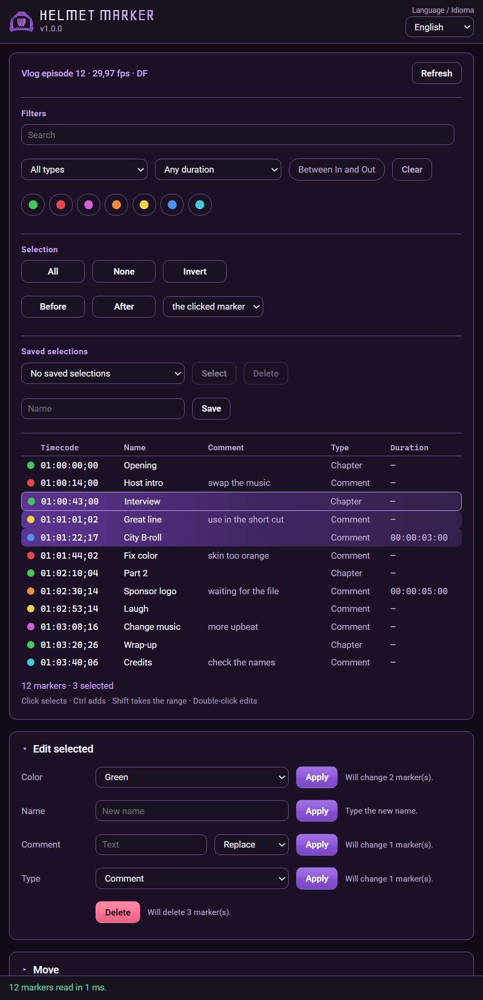

# Helmet Marker

**English** · [Português](README.pt-BR.md)

A **UXP** plugin for Adobe Premiere Pro: a panel to select and edit markers in bulk, something Premiere doesn't do on its own. Every bulk operation becomes **a single step in the history**, so one Ctrl+Z undoes all of it.

Same visual identity as [Helmet DL](https://github.com/derpbizinoto/helmet-dl), [Helmet Cutter](https://github.com/derpbizinoto/helmet-cutter) and [Helmet Library](https://github.com/derpbizinoto/helmet-library): Classic theme (Violet Terminal), Geo for the name and Roboto everywhere else.

Current version: **1.0.0**. What changed is in [CHANGELOG.md](CHANGELOG.md) (Portuguese).

Free and open source ([MIT license](LICENSE)).



**[⬇ Download the latest version](https://github.com/derpbizinoto/helmet-marker/releases/latest)**: Premiere Pro 26.5 or newer, Windows or macOS.

## What it does

- Lists the active sequence markers (drop-frame aware timecode, name, comment, color, type, duration). Clicking moves the playhead to the marker.
- Selection with click, Ctrl+click and Shift+click; select all, clear, invert; select before/after the clicked marker or the playhead.
- Filters by text, color, type, duration (point or ranged) and the sequence In/Out.
- Bulk edit of color, name, comment (replace or append) and type; delete with confirmation. Before applying, the panel shows how many markers will change.
- Move selected markers by X frames, ±1 frame, ±1 second, or everything from the playhead on; move a group of adjacent markers to the playhead, keeping their spacing. All math is done in whole frames.
- Export YouTube chapters (with warnings for YouTube rules) and CSV.
- Find and replace in names and comments; automatic numbering with prefix/suffix ("Scene 01, Scene 02…").
- Double-click a name or comment in the list to edit it right there.
- Marker templates (name, color, type, comment): apply to the selection or create a marker at the playhead.
- Saved selections with a name, per sequence.
- Import from a pasted list, CSV (including Premiere's own), SRT, EDL or JSON, with a preview; create a marker on every cut.
- Export a review list, plain text and JSON too.
- Copy markers to another sequence; bring clip markers into the sequence and send sequence markers to the clip.
- Color legend (what each color means).
- Keeps the list up to date: when the sequence changes and with a light check every few seconds (Premiere does not notify when a marker is added in the timeline).

## Requirements

- **Premiere Pro 26.5 or newer** (Windows or macOS).
- To load it during development: **UXP Developer Tool 2.2 or newer** (free, from Creative Cloud).
- To run the automated tests: **Node.js** (any current version).

## Install

1. Download the `.zip` of the latest version from the [releases page](https://github.com/derpbizinoto/helmet-marker/releases/latest) page and extract it.
2. Close Premiere.
3. Double-click `HelmetMarker-<version>.ccx`. The Creative Cloud app opens and installs the plugin.
4. Open Premiere and go to **Window › UXP Plugins › Helmet Marker**.

To update, do the same with the new version's `.ccx`. To remove it, use the plugins area of the Creative Cloud app.

## Load during development (UXP Developer Tool)

Once:

1. In the **Creative Cloud** app, go to **All apps**, search for **UXP Developer Tools** and click **Install**.
2. Open the **UXP Developer Tool**. The first time it asks to enable developer mode: click **Enable** (needs administrator rights).
3. In Premiere, go to **Settings › Plugins**, check **Enable developer mode** and restart Premiere.

Every time:

1. Open Premiere and a project.
2. In the UXP Developer Tool, click **Add Plugin** and choose `plugin\manifest.json` from this folder (first time only).
3. On the Helmet Marker row, click **••• › Load** (or **Load & Watch**, which reloads when the code changes).
4. The panel opens in Premiere. If you close it, reopen it from **Window › UXP Plugins › Helmet Marker**.
5. If `manifest.json` changes, click **Unload** and then **Load** again.
6. **Debug** opens the panel console.

## Package (.ccx)

- **Script:** in the project folder, run
  ```powershell
  powershell -ExecutionPolicy Bypass -File .\empacotar.ps1
  ```
  It runs the tests, checks the version and creates `dist\HelmetMarker-<version>.ccx` plus a `.zip` with the .ccx, license and readmes.
- **UXP Developer Tool:** on the plugin row, **••• › Package**, then choose a folder.

## Automated tests

```powershell
node tests\run-tests.js
```

They cover the part that doesn't depend on Premiere (`plugin\core\`): frame and timecode math at 23.976, 25, 29.97 (drop and non-drop), 59.94 and 60 fps, marker identity, colors, selection, offsets and translations. They don't replace testing inside Premiere.

## Code layout

| Folder | Contents |
|---|---|
| `plugin/core/` | Pure logic (frames, timecode, filters, selection, change plans, import and export). No Premiere calls; tested with Node. |
| `plugin/premiere/` | Thin layer that reads markers and applies changes in a single transaction. |
| `plugin/ui/` | The panel. |
| `plugin/strings/` | All interface text (Portuguese and English). |

## Language

The panel opens in English. Switch it in **Language / Idioma**, top right; the choice is remembered.
